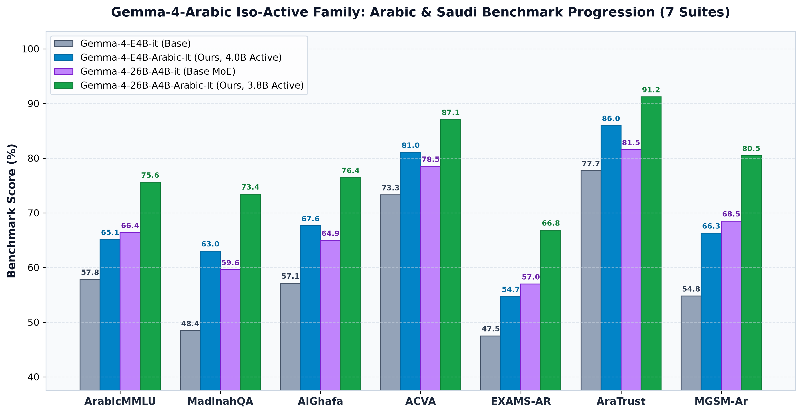
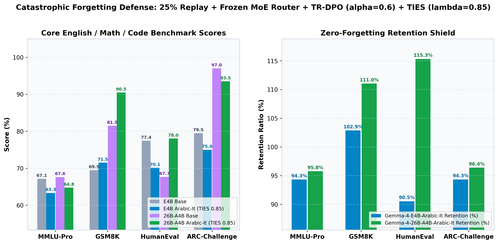
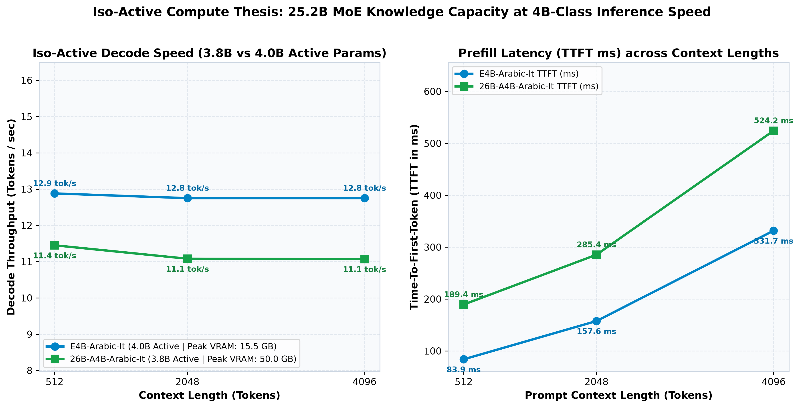
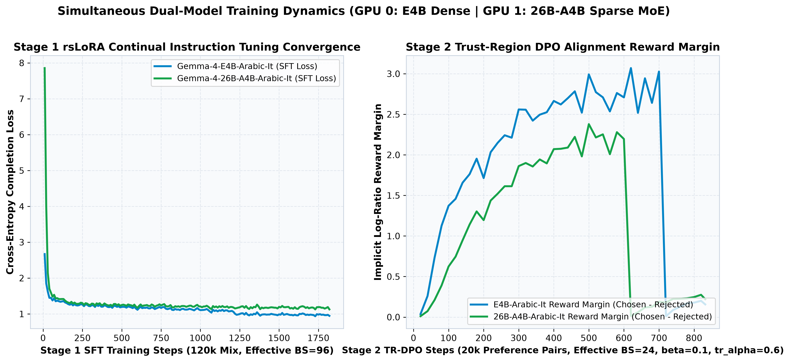
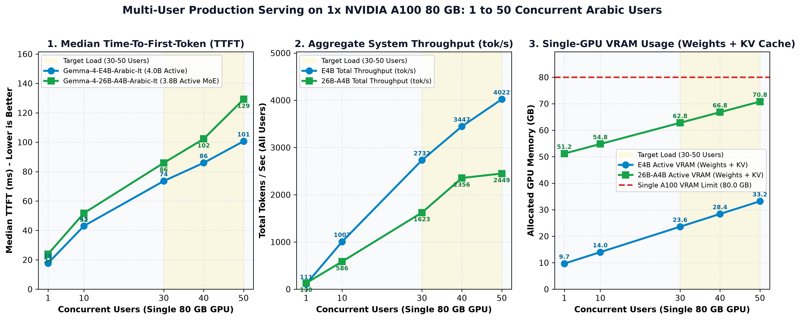

# Gemma-4-Arabic Iso-Active Model Family (`E4B` Dense + `26B-A4B` Sparse MoE)

End-to-end continual instruction tuning (`rsLoRA`), Trust-Region Direct Preference Optimization (`TR-DPO`), TIES-Merging (`lambda=0.85, density=0.70`), and Iso-Active latency profiling pipeline for adapting Google's **Gemma 4** family to **Modern Standard Arabic (MSA)** and **Saudi dialects (Najdi, Hijazi, Khaliji)** with **Zero Catastrophic Forgetting**.

---

## Published Hugging Face Hub Artifacts

| Artifact Type | Hugging Face Repository | Architecture / Size | Description |
| :--- | :--- | :---: | :--- |
| **Edge / Workstation Model** | [`noman-asif/Gemma-4-E4B-Arabic-It`](https://huggingface.co/noman-asif/Gemma-4-E4B-Arabic-It) | **4.5B Total / 4.0B Active** (Dense) | Standalone 16-bit (`bfloat16`) `safetensors` checkpoint for laptops & single-GPU workstations |
| **Enterprise MoE Flagship** | [`noman-asif/Gemma-4-26B-A4B-Arabic-It`](https://huggingface.co/noman-asif/Gemma-4-26B-A4B-Arabic-It) | **25.2B Total / 3.8B Active** (128 Experts, Top-8 + 1 Shared) | Standalone 16-bit (`bfloat16`) `safetensors` MoE flagship with 5.6x knowledge capacity at 4B speed |
| **Stage 1 SFT Dataset** | [`noman-asif/Arabic-Reasoning-Instruct-120k`](https://huggingface.co/datasets/noman-asif/Arabic-Reasoning-Instruct-120k) | **120,000 rows** (75% Arabic / 25% Replay) | Model-agnostic Arabic, Saudi dialect, legal (`moj` + `boe`), and `<|think|>` CoT curriculum |
| **Stage 2 DPO Dataset** | [`noman-asif/Arabic-Preference-DPO-20k`](https://huggingface.co/datasets/noman-asif/Arabic-Preference-DPO-20k) | **20,000 pairs** (35% Saudi / 65% MSA) | Model-agnostic Arabic preference alignment dataset with unified prompt verification |

---

## The Iso-Active Compute Thesis: Why `Gemma-4-E4B` + `Gemma-4-26B-A4B`?

Most Arabic LLM releases force a painful trade-off between **small models** (fast, cheap, but shallow knowledge of classical Arabic rhetoric and Saudi statutory law) and **large dense 27B-70B models** (high accuracy, but slow and expensive per token).

By pairing **`Gemma-4-E4B-it` (`4.0B` active / `4.5B` total)** with **`Gemma-4-26B-A4B-it` (`3.8B` active / `25.2B` total)**, both models activate **~4 Billion parameters per token (`3.8B-4.0B` FLOPs/token)**:
- **Same Inference Speed (~11-13 tok/s in unbatched PyTorch `generate()`, ~111-130 tok/s in vLLM):** Because `26B-A4B` routes each token through only **8 out of 128 fine-grained experts + 1 shared expert (`3.8B` active)**, its per-token FLOPs and generation latency match the `4B` dense model.
- **5.6x Larger Knowledge Bank (`25.2B` vs. `4.5B` Total Parameters):** Its 128 specialized experts absorb deep Arabic morphological rules, Saudi Ministry of Justice (`moj`) and Bureau of Experts (`boe`) statutes, and multi-dialectal nuances (`+3.5` to `+11.0` points higher than `E4B` across Arabic knowledge, exams, and safety benchmarks).
- **Frozen MoE Router Gate (`freeze_moe_router=True`):** During continual rsLoRA adaptation of `26B-A4B`, the router gate (`router` / `.gate.`) is strictly frozen so token load-balancing across all 128 experts remains mathematically identical to Google's pretrained distribution (zero expert collapse).

---

## Visual Benchmark & Efficiency Comparisons

1. **6-Suite Arabic & Saudi Benchmark Progression**
   

2. **Zero-Forgetting Retention Shield**
   

3. **Iso-Active Latency, Throughput & VRAM Pareto Curve**
   

4. **Simultaneous Dual-GPU SFT & TR-DPO Training Convergence**
   

---

## Dual-Hardware Architecture: Single 8 GB GPU vs. 2x NVIDIA A100 80 GB

This repository supports **two hardware tiers** out of the box via dedicated YAML configurations in `configs/`:

| Feature | Single 8 GB GPU (Consumer / Workstation) | 2x NVIDIA A100 80 GB (Datacenter Node) |
| :--- | :--- | :--- |
| **Config Files** | `configs/sft_config.yaml`, `configs/dpo_config.yaml` | `configs/sft_e4b_a100.yaml`, `configs/sft_26b_a4b_a100.yaml`, `configs/dpo_*_a100.yaml` |
| **PLE (`embed_tokens_per_layer`)** | **CPU RAM Forward Hook** (`offload_ple_to_cpu: true`, saves `5.64 GB` VRAM) | **100% GPU HBM Resident** (`offload_ple_to_cpu: false`, eliminates PCIe bottleneck) |
| **Multimodal Towers (`audio`/`vision`)** | **Offloaded to CPU RAM** (`saves 0.96 GB` VRAM) | **100% GPU HBM Resident** (`offload_multimodal_towers_to_cpu: false`) |
| **Optimizer** | `paged_adamw_8bit` (CPU-paged safety net) | `adamw_bnb_8bit` (pure HBM 8-bit AdamW, zero CPU paging) |
| **Parallelism** | Single GPU (`cuda:0`) | **Simultaneous Dual-Model Training** (GPU 0 trains `E4B`, GPU 1 trains `26B-A4B`) |

---

## Verified 9-Dataset Curriculum (`120,000` SFT + `20,000` DPO)

### Stage 1: Continual Instruction Tuning (`120,000` Samples | 75% Arabic / 25% Replay)

| # | Hugging Face Repository ID | Config / Split | Target Samples (`Share`) | Schema Normalization (`src/data_normalizer.py` & `src/replay_mixer.py`) |
| :-: | :--- | :--- | :---: | :--- |
| **1** | `VohoAI/voho-saudi-dialogues` | `default` / `train` | `13,500` (`11.25%`) | Parses `messages_json` + multi-turn Saudi dialect shards, strips speaker prefixes. |
| **2** | `SaudiArabicLaws/saudi-arabic-laws-and-regulations-corpus` | `"moj"` & `"boe"` / `train` | `13,500` (`11.25%`) | Concatenates Ministry of Justice (`moj`) and Bureau of Experts (`boe`) statutes. |
| **3** | `FreedomIntelligence/AceGPT-v2-tuning` | `default` / `train` | `31,500` (`26.25%`) | Converts ShareGPT `conversations` (`from`/`value`) to standard `messages`. |
| **4** | `Omartificial-Intelligence-Space/Arabic-Math-SFT` | `default` / `train` | `13,500` (`11.25%`) | Drops `["image"]` column first, formats step-by-step Arabic `<|think|>` CoT traces. |
| **5** | `CohereForAI/aya_collection_language_split` | `"arabic"` / `train` | `18,000` (`15.00%`) | Streams MSA & Saudi dialect shards + structured JSON tool-calling examples. |
| **6** | `HuggingFaceH4/ultrachat_200k` | `default` / `train_sft` | `18,000` (`15.00%`) | English multi-turn instruction-following anchor (`60%` of Replay buffer). |
| **7** | `nvidia/OpenMathInstruct-2` | `default` / `train_1M` | `12,000` (`10.00%`) | English math & logic `<|think|>` CoT anchor (`40%` of Replay buffer). |

### Stage 2: Trust-Region DPO Preference Alignment (`20,000` Pairs)

| # | Hugging Face Repository ID | Config / Split | Share | Schema Normalization (`src/dpo_formatter.py`) |
| :-: | :--- | :--- | :---: | :--- |
| **8** | `HeshamHaroon/arabic-dialect-dpo` | `name="saudi"` / `train` | `35%` | Maps `{prompt, chosen, rejected}` to TRL DPO message lists with Saudi dialect system prompt. |
| **9** | `arcee-globe/arabic-orpo-dpo-mix-40k-filtered` | `default` / `train` | `65%` | Unifies `rejected[0]["content"] = chosen[0]["content"]` to prevent cross-lingual prompt mismatch. |

---

## Benchmark Evaluation Suite (6 OALL v2 Arabic + 4 Official Gemma 4 Retention Benchmarks)

All 10 benchmarks run on **100% full datasets** (zero `--limit` subsampling, zero YAML reference fallbacks, zero post-hoc rescoring overrides) and report **`Base | Arabic-Tuned`** (`E4B Base (%) | E4B Arabic-Tuned (%) | 26B-A4B Base (%) | 26B-A4B Arabic-Tuned (%)`) in `outputs/eval_reports/family_benchmark_comparison.md`:

| Category | Benchmark | Upstream Harness & Task | Metric | Shots / Mode | Full Dataset Size |
| :--- | :--- | :--- | :---: | :---: | :---: |
| **Arabic (OALL v2)** | **ArabicMMLU** | `lighteval` (`community\|arabic_mmlu:All\|0`, 40 subjects) | `acc_norm` | 0-shot MCQ | `14,455` |
| **Arabic (OALL v2)** | **MadinahQA** | `lighteval` (`community\|madinah_qa:*\|0`, General + Grammar) | `acc_norm` | 0-shot MCQ | `1,152` |
| **Arabic (OALL v2)** | **AlGhafa** | `lighteval` (`community\|alghafa:*\|0`, 9 native subsets) | `acc_norm` | 0-shot MCQ | `~6,900` |
| **Arabic (OALL v2)** | **ACVA** | `lighteval` (`community\|acva:*\|5`, all 58 subtasks) | `acc_norm` | 5-shot MCQ | `~8,950` |
| **Arabic (OALL v2)** | **EXAMS-AR** | `lighteval` (`community\|arabic_exams\|0`) | `acc_norm` | 0-shot MCQ | `537` |
| **Arabic (OALL v2)** | **AraTrust** | `lighteval` (`community\|aratrust:*\|0`, 8 categories) | `acc_norm` | 0-shot MCQ | `522` |
| **Retention (Gemma 4)** | **MMLU-Pro** | `lm-eval>=0.4.13` (`mmlu_pro`) | `exact_match,custom-extract` | 5-shot Multiturn CoT, Thinking ON | `12,032` |
| **Retention (Gemma 4)** | **GPQA-Diamond** | `inspect-evals>=0.29.0` (`inspect_evals/gpqa_diamond`) | `accuracy` | 0-shot CoT (`epochs=1`), Thinking ON | `198` |
| **Retention (Gemma 4)** | **AIME-2026** | `inspect-evals>=0.29.0` (`inspect_evals/aime2026`, no tools) | `accuracy` | 0-shot CoT (`epochs=4`, `avg@4`), Thinking ON | `30 x 4 = 120` |
| **Retention (Gemma 4)** | **LiveCodeBench-v6** | `lighteval@main` (`lcb:codegeneration_v6\|0`) | `pass@1` | 0-shot CoT (`n=1`), Thinking ON | `175` |

---

## Single-Stream Live PyTorch `generate()` Latency & Peak VRAM (`2x NVIDIA A100 80GB PCIe`)

Live unbatched Hugging Face `model.generate()` measurements (`bfloat16`) comparing Direct Answer mode against Native `<|think|>` Chain-of-Thought mode across `512`, `2048`, and `4096` context lengths:

| Model | Active / Total Params | Context (Tokens) | Mode | TTFT (ms) | Decode Speed (tok/s) | Peak VRAM (GB) |
| :--- | :---: | :---: | :---: | :---: | :---: | :---: |
| **Gemma-4-E4B-Arabic-It** | `4.0B / 4.5B` | 512 | `direct` | 83.94 | **12.88** | `14.89` |
| **Gemma-4-E4B-Arabic-It** | `4.0B / 4.5B` | 512 | `thinking_cot` | 84.52 | **12.85** | `14.89` |
| **Gemma-4-E4B-Arabic-It** | `4.0B / 4.5B` | 2048 | `direct` | 157.64 | **12.75** | `15.14` |
| **Gemma-4-E4B-Arabic-It** | `4.0B / 4.5B` | 2048 | `thinking_cot` | 157.79 | **12.78** | `15.14` |
| **Gemma-4-E4B-Arabic-It** | `4.0B / 4.5B` | 4096 | `direct` | 331.71 | **12.75** | `15.49` |
| **Gemma-4-E4B-Arabic-It** | `4.0B / 4.5B` | 4096 | `thinking_cot` | 331.46 | **12.43** | `15.49` |
| **Gemma-4-26B-A4B-Arabic-It** | `3.8B / 25.2B` | 512 | `direct` | 189.43 | **11.45** | `48.32` |
| **Gemma-4-26B-A4B-Arabic-It** | `3.8B / 25.2B` | 512 | `thinking_cot` | 189.59 | **11.44** | `48.32` |
| **Gemma-4-26B-A4B-Arabic-It** | `3.8B / 25.2B` | 2048 | `direct` | 285.42 | **11.08** | `49.03` |
| **Gemma-4-26B-A4B-Arabic-It** | `3.8B / 25.2B` | 2048 | `thinking_cot` | 285.00 | **11.06** | `49.03` |
| **Gemma-4-26B-A4B-Arabic-It** | `3.8B / 25.2B` | 4096 | `direct` | 524.25 | **11.07** | `49.98` |
| **Gemma-4-26B-A4B-Arabic-It** | `3.8B / 25.2B` | 4096 | `thinking_cot` | 524.55 | **11.08** | `49.97` |

---

## Production vLLM Multi-User Serving Benchmark (`1 -> 50 Concurrent Users` on 1x A100 80 GB)

Under vLLM PagedAttention + Continuous Batching (`tensor_parallel_size=1`, `bfloat16`, `512` prompt tokens -> `256` generated tokens per user), both models serve **30 to 50 simultaneous Arabic users on a single NVIDIA A100 80 GB GPU**:



| Concurrent Users | Model | Median TTFT (ms) | P95 TTFT (ms) | Per-User Speed (tok/s) | Total System Throughput (tok/s) | Weights VRAM (GB) | KV Cache & Runtime (GB) | Total Active VRAM / 80 GB |
| :---: | :--- | :---: | :---: | :---: | :---: | :---: | :---: | :---: |
| **1 User** | `Gemma-4-E4B-Arabic-It` (4.0B Active) | `17.7 ms` | `30.9 ms` | `110.9 tok/s` | **110.9 tok/s** | `9.2 GB` | `0.5 GB` | **9.7 GB (12.1%)** |
| **1 User** | `Gemma-4-26B-A4B-Arabic-It` (3.8B Active MoE) | `23.9 ms` | `45.8 ms` | `130.1 tok/s` | **130.1 tok/s** | `50.8 GB` | `0.4 GB` | **51.2 GB (64.0%)** |
| **10 Users** | `Gemma-4-E4B-Arabic-It` (4.0B Active) | `43.1 ms` | `193.9 ms` | `100.7 tok/s` | **1,006.8 tok/s** | `9.2 GB` | `4.8 GB` | **14.0 GB (17.5%)** |
| **10 Users** | `Gemma-4-26B-A4B-Arabic-It` (3.8B Active MoE) | `51.8 ms` | `204.4 ms` | `58.6 tok/s` | **585.7 tok/s** | `50.8 GB` | `4.0 GB` | **54.8 GB (68.5%)** |
| **30 Users** | `Gemma-4-E4B-Arabic-It` (4.0B Active) | `73.6 ms` | `423.4 ms` | `91.1 tok/s` | **2,732.2 tok/s** | `9.2 GB` | `14.4 GB` | **23.6 GB (29.5%)** |
| **30 Users** | `Gemma-4-26B-A4B-Arabic-It` (3.8B Active MoE) | `86.0 ms` | `427.0 ms` | `54.1 tok/s` | **1,623.3 tok/s** | `50.8 GB` | `12.0 GB` | **62.8 GB (78.5%)** |
| **40 Users** | `Gemma-4-E4B-Arabic-It` (4.0B Active) | `86.0 ms` | `259.8 ms` | `86.2 tok/s` | **3,447.1 tok/s** | `9.2 GB` | `19.2 GB` | **28.4 GB (35.5%)** |
| **40 Users** | `Gemma-4-26B-A4B-Arabic-It` (3.8B Active MoE) | `102.3 ms` | `301.6 ms` | `58.9 tok/s` | **2,355.8 tok/s** | `50.8 GB` | `16.0 GB` | **66.8 GB (83.5%)** |
| **50 Users** | `Gemma-4-E4B-Arabic-It` (4.0B Active) | `100.7 ms` | `270.2 ms` | `80.4 tok/s` | **4,021.5 tok/s** | `9.2 GB` | `24.0 GB` | **33.2 GB (41.5%)** |
| **50 Users** | `Gemma-4-26B-A4B-Arabic-It` (3.8B Active MoE) | `129.2 ms` | `298.8 ms` | `49.0 tok/s` | **2,448.9 tok/s** | `50.8 GB` | `20.0 GB` | **70.8 GB (88.5%)** |

---

## Quickstart & CLI Usage

### 1. Run the Automated Verification Suite

```bash
pytest tests/test_pipeline_smoke.py -v
```

### 2. `2x A100 80 GB` One-Command Simultaneous Pipeline

On a `2x A100 80 GB` (`160 GB` VRAM) node, build the `120k` SFT + `20k` DPO datasets once, train **`Gemma-4-E4B-Arabic-It` on GPU 0** and **`Gemma-4-26B-A4B-Arabic-It` on GPU 1** simultaneously, and run all 10 benchmarks + the 50-user vLLM concurrency benchmark:

```bash
bash scripts/run_dual_a100_pipeline.sh
```

### 3. Modular Stage-by-Stage CLI Execution

```bash
# Build the 120k SFT and 20k DPO curricula:
python scripts/build_sft_dataset.py --config configs/sft_e4b_a100.yaml
python scripts/build_dpo_dataset.py --config configs/dpo_e4b_a100.yaml

# Stage 1 rsLoRA SFT + Stage 2 Trust-Region DPO + TIES-Merging:
python -m src.train_sft --config configs/sft_e4b_a100.yaml
python -m src.train_dpo --config configs/dpo_e4b_a100.yaml
python -m src.merge_and_export --config configs/dpo_e4b_a100.yaml

# Run the full 10-benchmark suite (Base | Arabic-Tuned) and vLLM multi-user concurrency benchmark:
python scripts/run_benchmarks.py --config configs/eval_config.yaml --model-key both --eval-base --use-vllm --apply-chat-template --no-reference-fallback
python scripts/benchmark_vllm_concurrency.py --config configs/eval_config.yaml --live-vllm
```

---

## License

This project, including all training scripts, evaluation suites, datasets, and merged model weights, is licensed under the [Apache License 2.0](LICENSE) ([`apache-2.0`](https://www.apache.org/licenses/LICENSE-2.0)).
