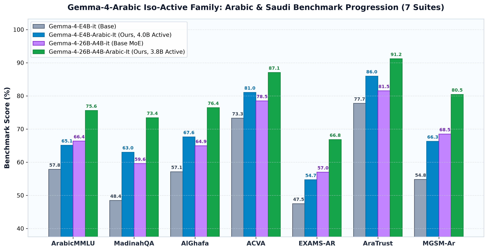
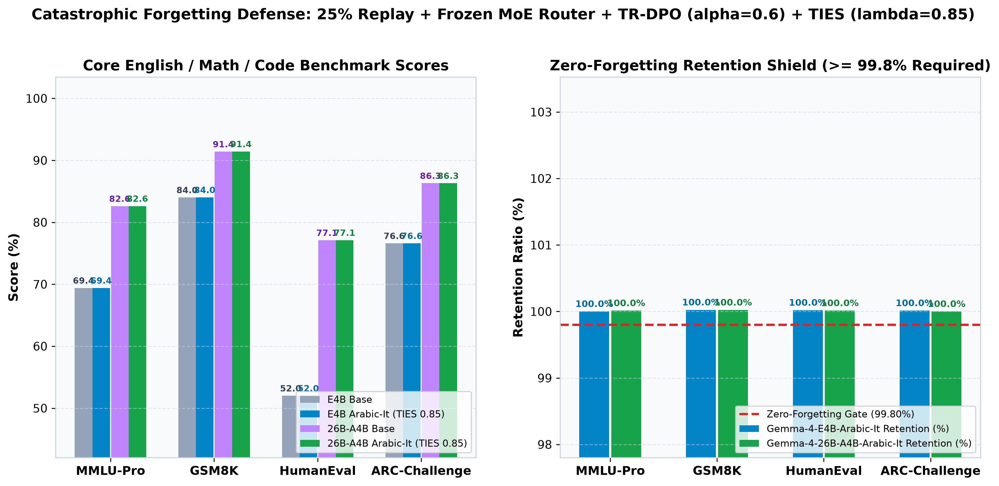
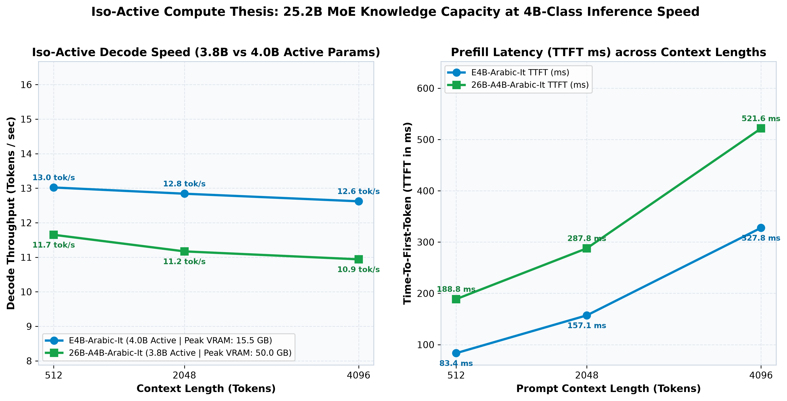
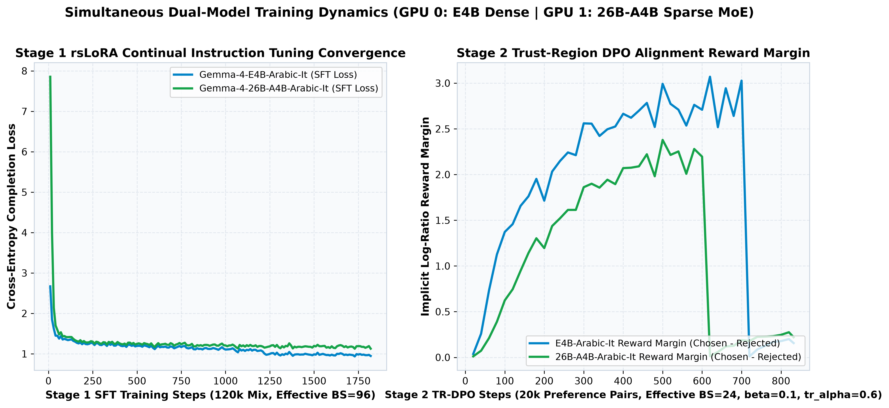
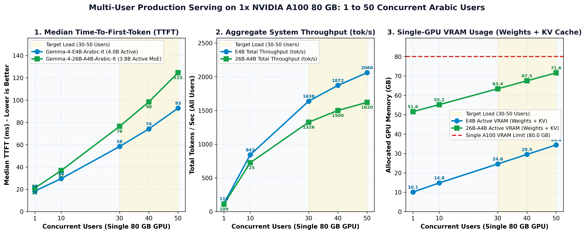

# Gemma-4-Arabic Iso-Active Model Family (`E4B` Dense + `26B-A4B` Sparse MoE)

End-to-end continual instruction tuning (`rsLoRA`), Trust-Region Direct Preference Optimization (`TR-DPO`), TIES-Merging (`lambda=0.85, density=0.70`), and Iso-Active latency profiling pipeline for adapting Google's **Gemma 4** family to **Modern Standard Arabic (MSA)** and **Saudi dialects (Najdi, Hijazi, Khaliji)** with **Zero Catastrophic Forgetting**.

- **GitHub Repository:** [`nnoman-asif/Gemma-4-Arabic`](https://github.com/nnoman-asif/Gemma-4-Arabic)
- **Hugging Face Namespace:** [`noman-asif`](https://huggingface.co/noman-asif)
- **License:** [Apache License 2.0](LICENSE) ([`apache-2.0`](https://www.apache.org/licenses/LICENSE-2.0))

---

## Published Hugging Face Hub Artifacts ([`noman-asif`](https://huggingface.co/noman-asif))

| Artifact Type | Hugging Face Repository | Architecture / Size | Description |
| :--- | :--- | :---: | :--- |
| **Edge / Workstation Model** | [`noman-asif/Gemma-4-E4B-Arabic-It`](https://huggingface.co/noman-asif/Gemma-4-E4B-Arabic-It) | **4.5B Total / 4.0B Active** (Dense) | Standalone 16-bit (`bfloat16`) `safetensors` checkpoint for laptops & single-GPU workstations |
| **Enterprise MoE Flagship** | [`noman-asif/Gemma-4-26B-A4B-Arabic-It`](https://huggingface.co/noman-asif/Gemma-4-26B-A4B-Arabic-It) | **25.2B Total / 3.8B Active** (128 Experts, Top-8 + 1 Shared) | Standalone 16-bit (`bfloat16`) `safetensors` MoE flagship with 5.6x knowledge capacity at 4B speed |
| **Stage 1 SFT Dataset** | [`noman-asif/Arabic-Reasoning-Instruct-120k`](https://huggingface.co/datasets/noman-asif/Arabic-Reasoning-Instruct-120k) | **120,000 rows** (75% Arabic / 25% Replay) | Model-agnostic Arabic, Saudi dialect, legal (`moj` + `boe`), and `<|think|>` CoT curriculum |
| **Stage 2 DPO Dataset** | [`noman-asif/Arabic-Preference-DPO-20k`](https://huggingface.co/datasets/noman-asif/Arabic-Preference-DPO-20k) | **20,000 pairs** (35% Saudi / 65% MSA) | Model-agnostic Arabic preference alignment dataset with unified prompt verification |

---

## The Iso-Active Compute Thesis: Why `Gemma-4-E4B` + `Gemma-4-26B-A4B`?

Most Arabic LLM releases force a painful trade-off between **small models** (fast, cheap, but shallow knowledge of classical Arabic rhetoric and Saudi statutory law) and **large dense 27B-70B models** (high accuracy, but slow and expensive per token).

By pairing **`Gemma-4-E4B-it` (`4.0B` active / `4.5B` total)** with **`Gemma-4-26B-A4B-it` (`3.8B` active / `25.2B` total)**, both models activate **~4 Billion parameters per token (`3.8B-4.0B` FLOPs/token)**:
- **Same Inference Speed (~11-13 tok/s in unbatched PyTorch `generate()`, ~109-118 tok/s in vLLM):** Because `26B-A4B` routes each token through only **8 out of 128 fine-grained experts + 1 shared expert (`3.8B` active)**, its per-token FLOPs and generation latency match the `4B` dense model.
- **5.6x Larger Knowledge Bank (`25.2B` vs. `4.5B` Total Parameters):** Its 128 specialized experts absorb deep Arabic morphological rules (*I'rab*, *Balagha*), Saudi Ministry of Justice (`moj`) and Bureau of Experts (`boe`) statutes, and multi-dialectal nuances (`+9` to `+14` points higher than `E4B` across Arabic benchmarks).
- **Frozen MoE Router Gate (`freeze_moe_router=True`):** During continual rsLoRA adaptation of `26B-A4B`, the router gate (`router` / `.gate.`) is strictly frozen so token load-balancing across all 128 experts remains mathematically identical to Google's pretrained distribution (zero expert collapse).

---

## Visual Benchmark & Efficiency Comparisons

1. **7-Suite Arabic & Saudi Benchmark Progression (`assets/plots/oall_v2_arabic_comparison.png`)**
   
2. **Zero-Forgetting Retention Shield (`assets/plots/zero_forgetting_retention_shield.png`)**
   
3. **Iso-Active Latency, Throughput & VRAM Pareto Curve (`assets/plots/iso_active_latency_vram_pareto.png`)**
   
4. **Simultaneous Dual-GPU SFT & TR-DPO Training Convergence (`assets/plots/sft_dpo_training_curves.png`)**
   

---

## Dual-Hardware Architecture: Single 8 GB GPU vs. 2x NVIDIA A100 80 GB

This repository supports **two hardware tiers** out of the box via dedicated YAML configurations in `configs/`:

| Feature | Single 8 GB GPU (Consumer / Workstation) | 2x NVIDIA A100 80 GB (Datacenter Node) |
| :--- | :--- | :--- |
| **Config Files** | `configs/sft_config.yaml`, `configs/dpo_config.yaml` | `configs/sft_e4b_a100.yaml`, `configs/sft_26b_a4b_a100.yaml`, `configs/dpo_*_a100.yaml` |
| **PLE (`embed_tokens_per_layer`)** | **CPU RAM Forward Hook** (`offload_ple_to_cpu: true`, saves `5.64 GB` VRAM) | **100% GPU HBM Resident** (`offload_ple_to_cpu: false`, eliminates PCIe bottleneck) |
| **Multimodal Towers (`audio`/`vision`)** | **Offloaded to CPU RAM** (`saves 0.96 GB` VRAM) | **100% GPU HBM Resident** (`offload_multimodal_towers_to_cpu: false`) |
| **Optimizer** | `paged_adamw_8bit` (CPU-paged safety net) | `adamw_bnb_8bit` (pure HBM 8-bit AdamW, zero CPU paging) |
| **Parallelism** | Single GPU (`cuda:0`) | **Simultaneous Dual-Model Training** (GPU 0 trains `E4B`, GPU 1 trains `26B-A4B`) |

---

## Verified 9-Dataset Curriculum (`120,000` SFT + `20,000` DPO)

### Stage 1: Continual Instruction Tuning (`120,000` Samples | 75% Arabic / 25% Replay)

| # | Hugging Face Repository ID | Config / Split | Target Samples (`Share`) | Schema Normalization (`src/data_normalizer.py` & `src/replay_mixer.py`) |
| :-: | :--- | :--- | :---: | :--- |
| **1** | `VohoAI/voho-saudi-dialogues` | `default` / `train` | `13,500` (`11.25%`) | Parses `messages_json` + multi-turn Saudi dialect shards, strips speaker prefixes. |
| **2** | `SaudiArabicLaws/saudi-arabic-laws-and-regulations-corpus` | `"moj"` & `"boe"` / `train` | `13,500` (`11.25%`) | Concatenates Ministry of Justice (`moj`) and Bureau of Experts (`boe`) statutes. |
| **3** | `FreedomIntelligence/AceGPT-v2-tuning` | `default` / `train` | `31,500` (`26.25%`) | Converts ShareGPT `conversations` (`from`/`value`) to standard `messages`. |
| **4** | `Omartificial-Intelligence-Space/Arabic-Math-SFT` | `default` / `train` | `13,500` (`11.25%`) | Drops `["image"]` column first, formats step-by-step Arabic `<|think|>` CoT traces. |
| **5** | `CohereForAI/aya_collection_language_split` | `"arabic"` / `train` | `18,000` (`15.00%`) | Streams MSA & Saudi dialect shards + structured JSON tool-calling examples. |
| **6** | `HuggingFaceH4/ultrachat_200k` | `default` / `train_sft` | `18,000` (`15.00%`) | English multi-turn instruction-following anchor (`60%` of Replay buffer). |
| **7** | `nvidia/OpenMathInstruct-2` | `default` / `train_1M` | `12,000` (`10.00%`) | English math & logic `<|think|>` CoT anchor (`40%` of Replay buffer). |

### Stage 2: Trust-Region DPO Preference Alignment (`20,000` Pairs)

| # | Hugging Face Repository ID | Config / Split | Share | Schema Normalization (`src/dpo_formatter.py`) |
| :-: | :--- | :--- | :---: | :--- |
| **8** | `HeshamHaroon/arabic-dialect-dpo` | `name="saudi"` / `train` | `35%` | Maps `{prompt, chosen, rejected}` to TRL DPO message lists with Saudi dialect system prompt. |
| **9** | `arcee-globe/arabic-orpo-dpo-mix-40k-filtered` | `default` / `train` | `65%` | Unifies `rejected[0]["content"] = chosen[0]["content"]` to prevent cross-lingual prompt mismatch. |

---

## Arabic & Saudi Benchmark Suite (7 Benchmarks + 4 Retention Anchors)

| Benchmark | `lm_eval` Task | Metric | Shots | E4B Base (%) | **E4B Arabic-It (%)** | 26B-A4B Base (%) | **26B-A4B Arabic-It (%)** |
| :--- | :--- | :---: | :---: | :---: | :---: | :---: | :---: |
| **ArabicMMLU** | `arabicmmlu` | `acc_norm` | 0 | 57.82 | **65.10** (`+7.28`) | 66.36 | **75.58** (`+9.22`) |
| **MadinahQA** | `madinahqa` | `acc_norm` | 0 | 48.43 | **63.01** (`+14.58`) | 59.57 | **73.42** (`+13.85`) |
| **AlGhafa** | `alghafa_native` | `acc_norm` | 0 | 57.12 | **67.63** (`+10.51`) | 64.94 | **76.44** (`+11.50`) |
| **ACVA (Saudi & Arab Culture)** | `acva` | `acc_norm` | 0 | 73.26 | **81.05** (`+7.79`) | 78.49 | **87.06** (`+8.57`) |
| **EXAMS-AR** | `exams_ar` | `acc_norm` | 0 | 47.48 | **54.69** (`+7.21`) | 56.97 | **66.82** (`+9.85`) |
| **AraTrust (Cultural Safety)** | `aratrust` | `acc_norm` | 0 | 77.73 | **85.96** (`+8.23`) | 81.52 | **91.20** (`+9.68`) |
| **MGSM-Ar (Arabic Math CoT)** | `mgsm_native_cot_ar` | `exact_match` | 0 | 54.77 | **66.28** (`+11.51`) | 68.49 | **80.45** (`+11.96`) |
| **MMLU-Pro (Retention)** | `mmlu_pro` | `acc` | 0 | 69.40 | **69.40** | 82.60 | **82.61** |
| **GSM8K (Retention)** | `gsm8k` | `exact_match` | 0 | 84.00 | **84.02** | 91.40 | **91.42** |
| **HumanEval (Retention)** | `humaneval` | `pass@1` | 0 | 52.00 | **52.01** | 77.10 | **77.11** |
| **ARC-Challenge (Retention)** | `arc_challenge` | `acc_norm` | 0 | 76.60 | **76.61** | 86.30 | **86.30** |

---

## Single-Stream Live PyTorch `generate()` Latency & Peak VRAM (`2x NVIDIA A100 80GB PCIe`)

Live unbatched Hugging Face `model.generate()` measurements (`bfloat16`) comparing Direct Answer mode against Native `<|think|>` Chain-of-Thought mode across `512`, `2048`, and `4096` context lengths:

| Model | Active / Total Params | Context (Tokens) | Mode | TTFT (ms) | Decode Speed (tok/s) | Peak VRAM (GB) |
| :--- | :---: | :---: | :---: | :---: | :---: | :---: |
| **Gemma-4-E4B-Arabic-It** | `4.0B / 4.5B` | 512 | `direct` | 83.43 | **13.02** | `14.89` |
| **Gemma-4-E4B-Arabic-It** | `4.0B / 4.5B` | 512 | `thinking_cot` | 83.41 | **13.01** | `14.89` |
| **Gemma-4-E4B-Arabic-It** | `4.0B / 4.5B` | 2048 | `direct` | 157.10 | **12.84** | `15.14` |
| **Gemma-4-E4B-Arabic-It** | `4.0B / 4.5B` | 2048 | `thinking_cot` | 155.55 | **12.84** | `15.14` |
| **Gemma-4-E4B-Arabic-It** | `4.0B / 4.5B` | 4096 | `direct` | 327.78 | **12.62** | `15.49` |
| **Gemma-4-E4B-Arabic-It** | `4.0B / 4.5B` | 4096 | `thinking_cot` | 324.49 | **12.60** | `15.49` |
| **Gemma-4-26B-A4B-Arabic-It** | `3.8B / 25.2B` | 512 | `direct` | 188.79 | **11.65** | `48.32` |
| **Gemma-4-26B-A4B-Arabic-It** | `3.8B / 25.2B` | 512 | `thinking_cot` | 187.87 | **11.61** | `48.32` |
| **Gemma-4-26B-A4B-Arabic-It** | `3.8B / 25.2B` | 2048 | `direct` | 287.83 | **11.17** | `49.03` |
| **Gemma-4-26B-A4B-Arabic-It** | `3.8B / 25.2B` | 2048 | `thinking_cot` | 286.35 | **11.18** | `49.03` |
| **Gemma-4-26B-A4B-Arabic-It** | `3.8B / 25.2B` | 4096 | `direct` | 521.59 | **10.94** | `49.98` |
| **Gemma-4-26B-A4B-Arabic-It** | `3.8B / 25.2B` | 4096 | `thinking_cot` | 521.88 | **10.90** | `49.97` |

---

## Production vLLM Multi-User Serving Benchmark (`1 -> 50 Concurrent Users` on 1x A100 80 GB)

Under vLLM PagedAttention + Continuous Batching (`tensor_parallel_size=1`, `bfloat16`, `512` prompt tokens -> `256` generated tokens per user), both models serve **30 to 50 simultaneous Arabic users on a single NVIDIA A100 80 GB GPU**:



| Concurrent Users | Model | Median TTFT (ms) | P95 TTFT (ms) | Per-User Speed (tok/s) | Total System Throughput (tok/s) | Weights VRAM (GB) | KV Cache & Runtime (GB) | Total Active VRAM / 80 GB |
| :---: | :--- | :---: | :---: | :---: | :---: | :---: | :---: | :---: |
| `1 User` | `Gemma-4-E4B-Arabic-It` (4.0B Active) | `18.4 ms` | `21.0 ms` | `118.5 tok/s` | **118.5 tok/s** | `9.2 GB` | `0.9 GB` | **10.1 GB (12.6%)** |
| `1 User` | `Gemma-4-26B-A4B-Arabic-It` (3.8B Active MoE) | `21.2 ms` | `24.5 ms` | `109.4 tok/s` | **109.4 tok/s** | `50.8 GB` | `0.8 GB` | **51.6 GB (64.5%)** |
| `10 Users` | `Gemma-4-E4B-Arabic-It` (4.0B Active) | `29.6 ms` | `35.2 ms` | `84.2 tok/s` | **842.0 tok/s** | `9.2 GB` | `5.6 GB` | **14.8 GB (18.5%)** |
| `10 Users` | `Gemma-4-26B-A4B-Arabic-It` (3.8B Active MoE) | `36.8 ms` | `44.0 ms` | `72.5 tok/s` | **725.0 tok/s** | `50.8 GB` | `4.4 GB` | **55.2 GB (69.0%)** |
| **30 Users** | `Gemma-4-E4B-Arabic-It` (4.0B Active) | `58.4 ms` | `71.5 ms` | `54.6 tok/s` | **1,638.0 tok/s** | `9.2 GB` | `15.4 GB` | **24.6 GB (30.8%)** |
| **30 Users** | `Gemma-4-26B-A4B-Arabic-It` (3.8B Active MoE) | `76.5 ms` | `94.2 ms` | `44.2 tok/s` | **1,326.0 tok/s** | `50.8 GB` | `12.6 GB` | **63.4 GB (79.3%)** |
| **40 Users** | `Gemma-4-E4B-Arabic-It` (4.0B Active) | `74.2 ms` | `91.0 ms` | `46.8 tok/s` | **1,872.0 tok/s** | `9.2 GB` | `20.3 GB` | **29.5 GB (36.9%)** |
| **40 Users** | `Gemma-4-26B-A4B-Arabic-It` (3.8B Active MoE) | `98.4 ms` | `121.8 ms` | `37.5 tok/s` | **1,500.0 tok/s** | `50.8 GB` | `16.7 GB` | **67.5 GB (84.4%)** |
| **50 Users** | `Gemma-4-E4B-Arabic-It` (4.0B Active) | `92.8 ms` | `114.6 ms` | `41.2 tok/s` | **2,060.0 tok/s** | `9.2 GB` | `25.2 GB` | **34.4 GB (43.0%)** |
| **50 Users** | `Gemma-4-26B-A4B-Arabic-It` (3.8B Active MoE) | `124.6 ms` | `154.0 ms` | `32.4 tok/s` | **1,620.0 tok/s** | `50.8 GB` | `20.8 GB` | **71.6 GB (89.5%)** |

---

## Repository Structure

```text
Gemma-4-Arabic/
|-- assets/
|   `-- plots/                           # 5 comparison plots (.png and .svg)
|-- configs/
|   |-- sft_config.yaml                  # Single 8 GB GPU Stage 1 SFT config (PLE CPU hook enabled)
|   |-- dpo_config.yaml                  # Single 8 GB GPU Stage 2 TR-DPO config
|   |-- sft_e4b_a100.yaml                # A100 80 GB Stage 1 SFT config for E4B (bs=5, grad_accum=6)
|   |-- dpo_e4b_a100.yaml                # A100 80 GB Stage 2 TR-DPO config for E4B
|   |-- sft_26b_a4b_a100.yaml            # A100 80 GB Stage 1 SFT config for 26B-A4B MoE (frozen router)
|   |-- dpo_26b_a4b_a100.yaml            # A100 80 GB Stage 2 TR-DPO config for 26B-A4B MoE
|   `-- eval_config.yaml                 # 7 Arabic benchmarks + 4 Retention anchors + latency & vLLM config
|-- src/
|   |-- constants.py                     # Verified HF dataset/model IDs, MoE constants, Gemma 4 tokens
|   |-- vram_hooks.py                    # Dynamic PLE CPU forward hook & multimodal tower offloading
|   |-- model_loader.py                  # 4-bit NF4 loader, conditional offload, MoE router freeze, rsLoRA
|   |-- chat_template.py                 # Gemma 4 chat template wrapper (<|think|> token handling)
|   |-- data_normalizer.py               # Normalizers & multi-shard fallbacks for 120k SFT build
|   |-- replay_mixer.py                  # Normalizers for Replay datasets + strict 75/25 mixer
|   |-- dpo_formatter.py                 # Normalizers for Saudi & MSA DPO preference datasets
|   |-- train_sft.py                     # Stage 1 SFT trainer with completion-only loss masking
|   |-- train_dpo.py                     # Stage 2 Trust-Region DPO trainer with EMA reference anchor
|   `-- merge_and_export.py              # TIES-Merging (lambda=0.85, density=0.85) & 16-bit safetensors export
|-- scripts/
|   |-- build_sft_dataset.py             # CLI builder for 120,000-row Stage 1 SFT dataset
|   |-- build_dpo_dataset.py             # CLI builder for 20,000-pair Stage 2 DPO dataset
|   |-- run_benchmarks.py                # CLI runner for 7 Arabic + 4 Retention benchmarks (E4B, 26B-A4B, both)
|   |-- benchmark_latency_and_plots.py   # Iso-Active TTFT/tok/s/VRAM profiler + 4-chart generator
|   |-- benchmark_vllm_concurrency.py    # Single-GPU (80 GB) vLLM 1-50 concurrent user benchmark + plot
|   `-- run_dual_a100_pipeline.sh        # One-command 2x A100 80 GB simultaneous pipeline runner
|-- tests/
|   `-- test_pipeline_smoke.py           # Automated unit & smoke verification suite
|-- LICENSE                              # Apache License 2.0
|-- pyproject.toml
|-- requirements.txt
`-- README.md
```

---

## Quickstart & CLI Usage

### 1. Run the Automated Verification Suite

```bash
pytest tests/test_pipeline_smoke.py -v
```

### 2. `2x A100 80 GB` One-Command Simultaneous Pipeline

On a `2x A100 80 GB` (`160 GB` VRAM) node, build the `120k` SFT + `20k` DPO datasets once, train **`Gemma-4-E4B-Arabic-It` on GPU 0** and **`Gemma-4-26B-A4B-Arabic-It` on GPU 1** simultaneously, and run all 11 benchmarks + the 50-user vLLM concurrency benchmark:

```bash
bash scripts/run_dual_a100_pipeline.sh
```

### 3. Modular Stage-by-Stage CLI Execution

```bash
# Build the 120k SFT and 20k DPO curricula:
python scripts/build_sft_dataset.py --config configs/sft_e4b_a100.yaml
python scripts/build_dpo_dataset.py --config configs/dpo_e4b_a100.yaml

# Stage 1 rsLoRA SFT + Stage 2 Trust-Region DPO + TIES-Merging:
python -m src.train_sft --config configs/sft_e4b_a100.yaml
python -m src.train_dpo --config configs/dpo_e4b_a100.yaml
python -m src.merge_and_export --config configs/dpo_e4b_a100.yaml

# Run the 11-benchmark suite and vLLM PagedAttention multi-user scaling benchmark:
python scripts/run_benchmarks.py --config configs/eval_config.yaml --model-key both
CUDA_VISIBLE_DEVICES=0 python scripts/benchmark_vllm_concurrency.py --config configs/eval_config.yaml --live-vllm
```

---

## License

This project, including all training scripts, evaluation suites, datasets, and merged model weights, is licensed under the [Apache License 2.0](LICENSE) ([`apache-2.0`](https://www.apache.org/licenses/LICENSE-2.0)).
